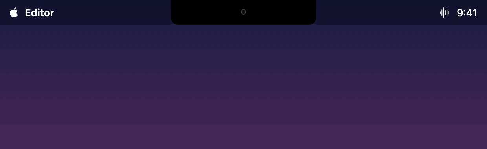

# Orator

Orator is a menu-bar dictation utility for macOS 27+ (Apple Silicon), built on Apple's on-device SpeechAnalyzer. Press your hotkey, speak, press again — your words land in the focused text field. Nothing you say leaves the Mac.



First launch guides you through Microphone and Accessibility permissions and a one-time model download from Apple.

See [SPEC.md](SPEC.md) for the full product & engineering specification.

## Build & run

Requires Xcode 27.2 or later (Swift 6.4, macOS 27.2 SDK). If `swift build` can't find an SDK, point the tools at Xcode with `sudo xcode-select -s /Applications/Xcode.app`.

```sh
swift build
swift test
bash Scripts/bundle.sh    # assemble Orator.app (release); set SIGN_ID + NOTARY_PROFILE to sign + notarize
```

`bundle.sh` produces `Orator.app` — the menu-bar app you run (`swift build` alone yields just the executable).

## License

[MIT](LICENSE)
